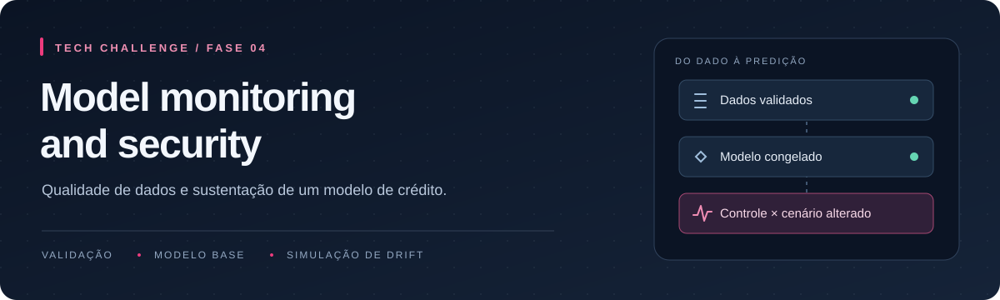
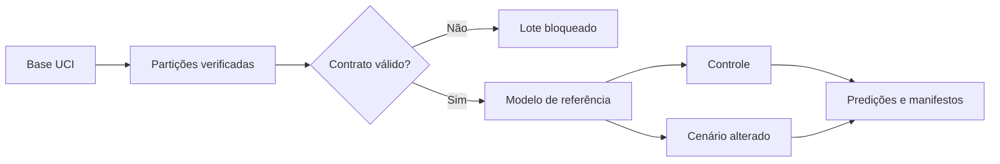

<p align="center">
  
</p>

<p align="center">
  <a href="https://www.python.org/downloads/release/python-31210/"></a>
  <a href="https://scikit-learn.org/stable/"></a>
  <a href="https://pandera.readthedocs.io/en/stable/"></a>
  <a href="tests/"></a>
  <a href="#andamento"></a>
</p>

<p align="center">
  <a href="#o-projeto">Projeto</a> ·
  <a href="#executar-localmente">Execução</a> ·
  <a href="#dados-e-contratos">Dados</a> ·
  <a href="#resultados-do-modelo">Resultados</a> ·
  <a href="#cenários-de-drift">Cenários</a> ·
  <a href="#andamento">Andamento</a>
</p>

## O projeto

Um modelo de crédito pode continuar respondendo mesmo quando os dados deixam de seguir o padrão do treino. Este projeto acompanha esse problema desde a entrada dos dados: valida o lote, treina um modelo de referência e compara suas predições em um controle e em dados alterados de forma conhecida.

Trabalho da **Fase 4 — Model monitoring and security**, do curso de Machine Learning Engineering da [FIAP](https://www.fiap.com.br/).

A implementação atual cobre preparação dos dados, contratos com [Pandera](https://pandera.readthedocs.io/en/stable/), modelo com [scikit-learn](https://scikit-learn.org/stable/) e simulação de Data Drift. A detecção estatística, o relatório com [Evidently](https://docs.evidentlyai.com/) e o rastreamento com [MLflow](https://mlflow.org/docs/latest/) são as próximas entregas.



## Executar localmente

Ambiente validado em **Windows x64, PowerShell e Python 3.12.10**. O arquivo de dependências inclui pacotes específicos de Windows; a instalação em outros sistemas ainda não foi verificada.

Pré-requisitos: [Git](https://git-scm.com/downloads), [Python 3.12.10](https://www.python.org/downloads/release/python-31210/) e [uv](https://docs.astral.sh/uv/getting-started/installation/). É necessário acesso ao repositório para clonar.

### 1. Instalar o ambiente

```powershell
git clone https://github.com/primodeckers/tech-challenge-fase-four.git
cd tech-challenge-fase-four

uv venv --python 3.12.10
uv pip sync --python .venv/Scripts/python.exe --require-hashes requirements.lock.txt
uv pip install --python .venv/Scripts/python.exe --no-deps -e .
```

As versões estão fixadas em [requirements.lock.txt](requirements.lock.txt), com hashes dos pacotes. O [pyproject.toml](pyproject.toml) reúne as dependências e a configuração do projeto. Não é necessário ativar o ambiente para usar os comandos abaixo.

### 2. Preparar os dados

```powershell
.venv/Scripts/python.exe -m credit_monitor.data
```

O comando baixa o arquivo oficial da UCI, verifica o SHA-256 e cria as partições em `data/processed/`:

- **Referência — 18.000 registros:** treino do modelo e do escalonamento.
- **Calibração — 6.000 registros:** escolha dos limiares e avaliação de desenvolvimento.
- **Produção simulada — 6.000 registros:** controle e cenários posteriores.

O [módulo de dados](src/credit_monitor/data.py) usa estratificação pelo alvo e seed **42**. Os IDs são disjuntos entre as partições. A divisão é aleatória, sem interpretação cronológica. O manifesto registra origem, licença, versões e hashes; `profile.json` reúne a inspeção dos dados.

### 3. Treinar e avaliar o modelo

```powershell
.venv/Scripts/python.exe -m credit_monitor.experiment --output-dir artifacts/baseline
```

Essa execução ajusta o modelo somente na referência, escolhe os limiares na calibração e salva:

```text
artifacts/baseline/
├── models.pkl       Modelo e comparador
├── manifest.json    Features, limiares, versões e integridade
└── report.json      Métricas, configuração e origem dos dados
```

O destino precisa ser uma pasta nova. Para repetir o experimento, escolha outro nome em `--output-dir`; artefatos existentes não são sobrescritos.

### 4. Gerar os cenários e suas predições

```powershell
.venv/Scripts/python.exe -m credit_monitor.scenario_run --model-dir artifacts/baseline --output-dir artifacts/scenarios --trusted-model
```

O comando reutiliza o artefato do passo anterior. Modelo, escalonamento e limiar permanecem iguais nos dois cenários.

```text
artifacts/scenarios/
├── control.csv
├── data_drift.csv
├── control_predictions.csv
├── data_drift_predictions.csv
└── manifest.json
```

`--trusted-model` é uma confirmação explícita para carregar o modelo local que acabou de ser gerado. O formato usa pickle: carregue apenas artefatos de origem conhecida. Versões e checksum são conferidos, mas um hash não comprova autoria.

### 5. Rodar os testes

```powershell
.venv/Scripts/python.exe -m pytest -q
```

**120 testes verificados.** As [fixtures são sintéticas](tests/) e os testes não precisam de rede nem da base completa. Cobrem contratos, bloqueio de lotes, partições, treino, métricas, persistência, cenários e reprodução dos arquivos. O badge indica a última verificação local; ainda não há execução de CI configurada.

## Dados e contratos

A base é a [Default of Credit Card Clients, da UCI](https://archive.ics.uci.edu/dataset/350/default+of+credit+card+clients): **30 mil registros**, 23 variáveis explicativas e alvo binário de inadimplência no mês seguinte. O arquivo também contém um identificador.

São dados históricos de Taiwan, com pagamentos de abril a setembro de 2005. A base é usada como experimento acadêmico; os resultados não representam uma carteira de crédito brasileira atual.

Os [contratos de ingestão](src/credit_monitor/contracts.py) distinguem treino, com alvo, de inferência, sem alvo. Entre as verificações estão:

- Colunas obrigatórias, nomes únicos, tipo `int64` e ausência de nulos.
- ID único dentro do lote e lote não vazio.
- Idade de **19 a 100 anos** e limite de crédito positivo.
- Domínios explícitos para os códigos de pagamento e atributos cadastrais.
- Pagamentos não negativos; faturas negativas e códigos especiais encontrados na fonte são preservados.

A faixa de idade é uma regra de plausibilidade adotada no experimento. O contrato rejeita valores inválidos; não faz imputação, conversão de tipos ou descarte silencioso de linhas.

`validate_batch` devolve o lote validado ou levanta `InvalidBatch`, com regras e contagens agregadas. `execute_validated` impede que um lote rejeitado chegue à operação seguinte. O resumo não inclui valores dos clientes, IDs ou índices de linhas.

## Resultados do modelo

O [modelo inicial](src/credit_monitor/baseline.py) combina **StandardScaler e regressão logística**, comparado a um `DummyClassifier` que aprende a frequência das classes no treino. Ambos usam 20 features. `ID`, `SEX`, `EDUCATION`, `MARRIAGE` e o alvo ficam fora das entradas do modelo.

Na calibração, **47 registros tinham as mesmas 20 features de registros do treino**. Eles foram retirados da escolha do limiar e da avaliação principal, sem alterar os arquivos originais. A comparação principal usa os **5.953 registros restantes**.

No experimento de 26/10/2026, a regressão logística apresentou:

- **ROC-AUC:** 0,7052, contra 0,5000 do comparador.
- **Average precision:** 0,4786, contra 0,2199.
- **Precisão / recall:** 0,5323 / 0,4782.
- **F1:** 0,5038, contra 0,3605.
- **Brier:** 0,1476, contra 0,1715; menor é melhor.

O limiar escolhido foi **0,27** para a regressão e **0,22** para o comparador. A política maximiza F1 em uma grade de 0,05 a 0,95, com passo de 0,01; em caso de empate, escolhe o maior limiar. Não houve ajuste de custos financeiros nem calibração das probabilidades.

> A escolha do limiar e a avaliação usam a mesma calibração. Esses números são resultados de desenvolvimento, sujeitos a otimismo, e não uma estimativa independente de desempenho em produção. Remover perfis exatamente iguais também não comprova independência entre pessoas.

O relatório inclui a matriz de confusão, os resultados com limiar 0,5 e uma análise nos 6 mil registros originais de calibração, mantendo o limiar já escolhido. A [persistência](src/credit_monitor/model_store.py) verifica versões, features e hash, e a recarga preserva as probabilidades e decisões.

## Cenários de drift

A [simulação](src/credit_monitor/scenarios.py) preserva um controle com os 6 mil registros originais de produção. No cenário alterado:

```text
LIMIT_BAL = floor(valor original × 3 / 2)
PAY_AMT1  = floor(valor original / 2)
```

As transformações são determinísticas, sem sorteio. IDs, ordem, rótulos históricos e demais colunas são preservados. Overflow e transformação sem mudança efetiva são rejeitados.

Na execução de 26/10/2026, o limite mudou em **6.000 registros**, e o pagamento mudou em **4.935**. Os 1.065 pagamentos originalmente zero continuaram zero.

Com o mesmo modelo e limiar, o controle teve **1.235 predições positivas**, e o cenário alterado teve **1.198**. Ao todo, **53 decisões mudaram**; a diferença líquida de positivas foi 37. Essa resposta do modelo não é uma medida de acurácia nem prova de causalidade econômica: os rótulos históricos não descrevem o que aconteceria depois da intervenção.

Há 56 registros de produção com perfis das 20 features já vistos na referência. Eles permanecem no cenário, e essa limitação é registrada no manifesto. A detecção estatística das mudanças será acrescentada na próxima etapa.

O [comando de cenários](src/credit_monitor/scenario_run.py) registra as intensidades, os hashes e as predições. Duas execuções locais produziram os cinco arquivos idênticos byte a byte.

## Organização do repositório

```text
tech-challenge-fase-four/
├── assets/readme/             Capa do projeto
├── src/credit_monitor/
│   ├── data.py                Aquisição, inspeção e partições
│   ├── contracts.py           Contratos e bloqueio de lotes
│   ├── baseline.py            Treino, predição e métricas
│   ├── model_store.py         Persistência e integridade
│   ├── experiment.py          Execução do modelo inicial
│   ├── scenarios.py           Controle e transformações
│   └── scenario_run.py        Execução dos cenários
├── tests/                    Testes com dados sintéticos
├── pyproject.toml
└── requirements.lock.txt
```

`data/`, `artifacts/`, `.venv/` e `docs/` são diretórios locais, excluídos pelo [.gitignore](.gitignore). O repositório contém o código e os comandos necessários para gerar os dados e artefatos; os PDFs didáticos e o planejamento de estudo não são publicados.

## Andamento

- [x] Ambiente e aquisição da base oficial.
- [x] Partições reproduzíveis e contratos de dados.
- [x] Modelo inicial, comparação, limiar e persistência.
- [x] Controle, Data Drift simulado e predições congeladas.
- [ ] PSI, KS e relatório HTML com Evidently.
- [ ] Cenário separado de Concept Drift.
- [ ] Pipeline com logs, métricas, alertas e MLflow.
- [ ] Análise de vieses, governança e reprodução completa.
- [ ] Vídeo de demonstração e revisão final da entrega.

O histórico de implementação está nos [commits](https://github.com/primodeckers/tech-challenge-fase-four/commits/feat/preparacao-dados/). O desenvolvimento segue em entregas pequenas, acompanhadas de testes.

## Cuidados com os dados

O uso atual é acadêmico, sem decisões financeiras reais. Dados, predições individuais e modelos ficam locais. Diagnósticos de rejeição usam contagens e nomes de regras; relatórios destinados ao repositório precisam ser revisados antes da publicação.

A exclusão de atributos cadastrais do treino não elimina possíveis vieses. A avaliação por grupos, a política de retenção, os responsáveis e a análise de governança ainda serão consolidados na etapa correspondente.

## Referências

- **Dataset:** Yeh, I. (2009). *Default of Credit Card Clients*. UCI Machine Learning Repository. [DOI: 10.24432/C55S3H](https://doi.org/10.24432/C55S3H). Dados sob [CC BY 4.0](https://creativecommons.org/licenses/by/4.0/).
- **Preparação e análise:** [pandas](https://pandas.pydata.org/docs/) e [NumPy](https://numpy.org/doc/stable/).
- **Validação:** [Pandera](https://pandera.readthedocs.io/en/stable/).
- **Modelo e avaliação:** [scikit-learn](https://scikit-learn.org/stable/), [métricas](https://scikit-learn.org/stable/modules/model_evaluation.html) e [persistência de modelos](https://scikit-learn.org/stable/model_persistence.html).
- **Próximas integrações:** [Evidently](https://docs.evidentlyai.com/) e [MLflow](https://mlflow.org/docs/latest/).
- **Ambiente e testes:** [uv](https://docs.astral.sh/uv/) e [pytest](https://docs.pytest.org/en/stable/).

---

<p align="center">
  <a href="https://github.com/primodeckers">primodeckers</a> ·
  <a href="https://github.com/primodeckers/tech-challenge-fase-four">Repositório</a> ·
  <a href="#o-projeto">Voltar ao início ↑</a>
</p>
