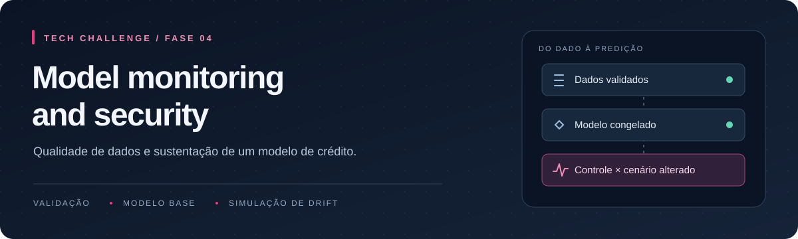
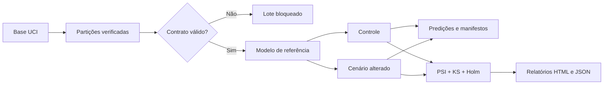

<p align="center">
  
</p>

<p align="center">
  <a href="https://www.python.org/downloads/release/python-31210/"></a>
  <a href="https://scikit-learn.org/stable/"></a>
  <a href="https://pandera.readthedocs.io/en/stable/"></a>
  <a href="tests/"></a>
  <a href="#andamento"></a>
</p>

<p align="center">
  <a href="#o-projeto">Projeto</a> ·
  <a href="#executar-localmente">Execução</a> ·
  <a href="#dados-e-contratos">Dados</a> ·
  <a href="#resultados-do-modelo">Resultados</a> ·
  <a href="#cenários-de-drift">Cenários</a> ·
  <a href="#detecção-de-drift">Detecção</a> ·
  <a href="#concept-drift">Conceito</a> ·
  <a href="#pipeline-e-telemetria">Pipeline</a> ·
  <a href="#andamento">Andamento</a>
</p>

## O projeto

Um modelo de crédito pode continuar respondendo mesmo quando os dados deixam de seguir o padrão do treino. Este projeto acompanha esse problema desde a entrada dos dados: valida o lote, treina um modelo de referência e compara suas predições em um controle e em dados alterados de forma conhecida.

Trabalho da **Fase 4 — Model monitoring and security**, do curso de Machine Learning Engineering da [FIAP](https://www.fiap.com.br/).

A implementação atual cobre preparação dos dados, contratos com [Pandera](https://pandera.readthedocs.io/en/stable/), modelo com [scikit-learn](https://scikit-learn.org/stable/), Data Drift com PSI, KS e relatórios [Evidently](https://docs.evidentlyai.com/), além de Concept Drift sintético. O pipeline reúne essas etapas e registra eventos, métricas e alertas por execução. A próxima integração é o rastreamento com [MLflow](https://mlflow.org/docs/latest/).



## Executar localmente

Ambiente validado em **Windows x64, PowerShell e Python 3.12.10**. O arquivo de dependências inclui pacotes específicos de Windows; a instalação em outros sistemas ainda não foi verificada.

Pré-requisitos: [Git](https://git-scm.com/downloads), [Python 3.12.10](https://www.python.org/downloads/release/python-31210/) e [uv](https://docs.astral.sh/uv/getting-started/installation/). É necessário acesso ao repositório para clonar.

### 1. Instalar o ambiente

```powershell
git clone https://github.com/primodeckers/tech-challenge-fase-four.git
cd tech-challenge-fase-four

uv venv --python 3.12.10
uv pip sync --python .venv/Scripts/python.exe --require-hashes requirements.lock.txt
uv pip install --python .venv/Scripts/python.exe --no-deps -e .
```

As versões estão fixadas em [requirements.lock.txt](requirements.lock.txt), com hashes dos pacotes. O [pyproject.toml](pyproject.toml) reúne as dependências e a configuração do projeto. Não é necessário ativar o ambiente para usar os comandos abaixo.

### 2. Preparar os dados

```powershell
.venv/Scripts/python.exe -m credit_monitor.data
```

O comando baixa o arquivo oficial da UCI, verifica o SHA-256 e cria as partições em `data/processed/`:

- **Referência — 18.000 registros:** treino do modelo e do escalonamento.
- **Calibração — 6.000 registros:** escolha dos limiares e avaliação de desenvolvimento.
- **Produção simulada — 6.000 registros:** controle e cenários posteriores.

O [módulo de dados](src/credit_monitor/data.py) usa estratificação pelo alvo e seed **42**. Os IDs são disjuntos entre as partições. A divisão é aleatória, sem interpretação cronológica. O manifesto registra origem, licença, versões e hashes; `profile.json` reúne a inspeção dos dados.

### 3. Treinar e avaliar o modelo

```powershell
.venv/Scripts/python.exe -m credit_monitor.experiment --output-dir artifacts/baseline
```

Essa execução ajusta o modelo somente na referência, escolhe os limiares na calibração e salva:

```text
artifacts/baseline/
├── models.pkl       Modelo e comparador
├── manifest.json    Features, limiares, versões e integridade
└── report.json      Métricas, configuração e origem dos dados
```

O destino precisa ser uma pasta nova. Para repetir o experimento, escolha outro nome em `--output-dir`; artefatos existentes não são sobrescritos.

### 4. Gerar os cenários e suas predições

```powershell
.venv/Scripts/python.exe -m credit_monitor.scenario_run --model-dir artifacts/baseline --output-dir artifacts/scenarios --trusted-model
```

O comando reutiliza o artefato do passo anterior. Modelo, escalonamento e limiar permanecem iguais nos dois cenários.

```text
artifacts/scenarios/
├── control.csv
├── data_drift.csv
├── control_predictions.csv
├── data_drift_predictions.csv
└── manifest.json
```

`--trusted-model` é uma confirmação explícita para carregar o modelo local que acabou de ser gerado. O formato usa pickle: carregue apenas artefatos de origem conhecida. Versões e checksum são conferidos, mas um hash não comprova autoria.

### 5. Comparar as distribuições e gerar os relatórios

```powershell
.venv/Scripts/python.exe -m credit_monitor.drift_run --scenarios-dir artifacts/scenarios --output-dir artifacts/drift
```

O comando calibra a política nos dados reservados e a salva antes de consumir os cenários. Depois gera as comparações e os relatórios:

```text
artifacts/drift/
├── policy.json          Bins, envelopes e configuração da calibração
├── comparisons.json     PSI, KS, p-valores corrigidos e decisões
├── evidently.json       Resultados do adaptador Evidently
├── overview.html        Resumo com scores, limites e links
├── control.html         Relatório Evidently do controle
├── data_drift.html      Relatório Evidently do cenário alterado
└── manifest.json        Integridade e origem dos artefatos
```

Abra `artifacts/drift/overview.html` no navegador. As duas comparações usam a mesma referência e a mesma política. Escolha uma pasta nova em `--output-dir` para repetir a execução.

### 6. Simular uma mudança na relação com o alvo

```powershell
.venv/Scripts/python.exe -m credit_monitor.concept_run --model-dir artifacts/baseline --output-dir artifacts/concept --trusted-model
```

Esse cenário parte da produção original, separado das alterações de features do passo 4. Mantém X, modelo e limiar; modifica apenas parte dos rótulos por uma regra fixa descrita em [Concept Drift](#concept-drift).

```text
artifacts/concept/
├── control.csv           Produção original
├── concept_drift.csv     Mesmas entradas, parte dos rótulos alterada
├── predictions.csv       Um vetor de predições compartilhado pelo par
├── label_changes.csv     Registro local dos rótulos alterados
├── report.json           Métricas globais e por segmento, antes/depois
└── manifest.json         Regra, seed, integridade e origem
```

Os CSVs individuais permanecem locais. O relatório registra contagens e métricas agregadas. Para repetir, use outro destino; nenhuma execução existente é sobrescrita.

### 7. Executar o pipeline

Com os dados, o modelo do passo 3 e a política do passo 5 no lugar, escolha um cenário por execução.

```powershell
.venv/Scripts/python.exe -m credit_monitor.cli control --trusted-model
.venv/Scripts/python.exe -m credit_monitor.cli data_drift --trusted-model
.venv/Scripts/python.exe -m credit_monitor.cli concept_drift --trusted-model
```

Para usar um lote próprio, indique o CSV com `--batch`. Use `--model-dir` e `--policy-dir` se tiver escolhido outros nomes de pasta nos passos anteriores.

### 8. Rodar os testes

```powershell
.venv/Scripts/python.exe -m pytest -q
```

**237 testes verificados localmente**, com dados sintéticos. A suíte cobre preparação, contratos, modelo, cenários de drift, Evidently, telemetria, isolamento de execuções e os estados da CLI. [Ver testes](tests/)

## Dados e contratos

A base é a [Default of Credit Card Clients, da UCI](https://archive.ics.uci.edu/dataset/350/default+of+credit+card+clients): **30 mil registros**, 23 variáveis explicativas e alvo binário de inadimplência no mês seguinte. O arquivo também contém um identificador.

São dados históricos de Taiwan, com pagamentos de abril a setembro de 2005. A base é usada como experimento acadêmico; os resultados não representam uma carteira de crédito brasileira atual.

Os [contratos de ingestão](src/credit_monitor/contracts.py) distinguem treino, com alvo, de inferência, sem alvo. Entre as verificações estão:

- Colunas obrigatórias, nomes únicos, tipo `int64` e ausência de nulos.
- ID único dentro do lote e lote não vazio.
- Idade de **19 a 100 anos** e limite de crédito positivo.
- Domínios explícitos para os códigos de pagamento e atributos cadastrais.
- Pagamentos não negativos; faturas negativas e códigos especiais encontrados na fonte são preservados.

A faixa de idade é uma regra de plausibilidade adotada no experimento. O contrato rejeita valores inválidos; não faz imputação, conversão de tipos ou descarte silencioso de linhas.

`validate_batch` devolve o lote validado ou levanta `InvalidBatch`, com regras e contagens agregadas. `execute_validated` impede que um lote rejeitado chegue à operação seguinte. O resumo não inclui valores dos clientes, IDs ou índices de linhas.

## Resultados do modelo

O [modelo inicial](src/credit_monitor/baseline.py) combina **StandardScaler e regressão logística**, comparado a um `DummyClassifier` que aprende a frequência das classes no treino. Ambos usam 20 features. `ID`, `SEX`, `EDUCATION`, `MARRIAGE` e o alvo ficam fora das entradas do modelo.

Na calibração, **47 registros tinham as mesmas 20 features de registros do treino**. Eles foram retirados da escolha do limiar e da avaliação principal, sem alterar os arquivos originais. A comparação principal usa os **5.953 registros restantes**.

No experimento de 26/10/2026, a regressão logística apresentou:

- **ROC-AUC:** 0,7052, contra 0,5000 do comparador.
- **Average precision:** 0,4786, contra 0,2199.
- **Precisão / recall:** 0,5323 / 0,4782.
- **F1:** 0,5038, contra 0,3605.
- **Brier:** 0,1476, contra 0,1715; menor é melhor.

O limiar escolhido foi **0,27** para a regressão e **0,22** para o comparador. A política maximiza F1 em uma grade de 0,05 a 0,95, com passo de 0,01; em caso de empate, escolhe o maior limiar. Não houve ajuste de custos financeiros nem calibração das probabilidades.

> A escolha do limiar e a avaliação usam a mesma calibração. Esses números são resultados de desenvolvimento, sujeitos a otimismo, e não uma estimativa independente de desempenho em produção. Remover perfis exatamente iguais também não comprova independência entre pessoas.

O relatório inclui a matriz de confusão, os resultados com limiar 0,5 e uma análise nos 6 mil registros originais de calibração, mantendo o limiar já escolhido. A [persistência](src/credit_monitor/model_store.py) verifica versões, features e hash, e a recarga preserva as probabilidades e decisões.

## Cenários de drift

A [simulação](src/credit_monitor/scenarios.py) preserva um controle com os 6 mil registros originais de produção. No cenário alterado:

```text
LIMIT_BAL = floor(valor original × 3 / 2)
PAY_AMT1  = floor(valor original / 2)
```

As transformações são determinísticas, sem sorteio. IDs, ordem, rótulos históricos e demais colunas são preservados. Overflow e transformação sem mudança efetiva são rejeitados.

Na execução de 26/10/2026, o limite mudou em **6.000 registros**, e o pagamento mudou em **4.935**. Os 1.065 pagamentos originalmente zero continuaram zero.

Com o mesmo modelo e limiar, o controle teve **1.235 predições positivas**, e o cenário alterado teve **1.198**. Ao todo, **53 decisões mudaram**; a diferença líquida de positivas foi 37. Essa resposta do modelo não é uma medida de acurácia nem prova de causalidade econômica: os rótulos históricos não descrevem o que aconteceria depois da intervenção.

Há 56 registros de produção com perfis das 20 features já vistos na referência. Eles permanecem no cenário, e essa limitação é registrada no manifesto.

O [comando de cenários](src/credit_monitor/scenario_run.py) registra as intensidades, os hashes e as predições. Duas execuções locais produziram os cinco arquivos idênticos byte a byte.

## Detecção de drift

O [módulo estatístico](src/credit_monitor/drift.py) compara as 20 features do modelo com a referência de treino. ID, alvo e atributos cadastrais excluídos do modelo ficam fora dos testes.

O PSI usa até dez bins quantílicos definidos pela referência, com bordas que cobrem os extremos e pseudocontagem de 0,5 por bin. Isso permite tratar bins sem ocorrências sem descartar valores. O KS informa a distância **D**, entre 0 e 1, e um p-valor bilateral assintótico. Como a base tem valores repetidos, esse p-valor é uma aproximação sob o modelo contínuo; não deve ser interpretado como probabilidade de uma hipótese ser verdadeira.

Os limites de PSI e D são definidos separadamente por feature, com **200 reamostragens da calibração**, seed **42** e percentil **99**. Um alerta exige PSI e D acima dos respectivos limites e p-valor corrigido por **Holm** de até 0,05. A correção cobre as 20 features de cada comparação; monitoramento repetido no tempo exigirá tratamento adicional. Esses envelopes são critérios empíricos de operação, sem garantia de taxa global de falso alerta.

Não usamos 0,1 ou 0,25 como regras universais de PSI. Amostras com menos de 200 linhas, tamanhos de lote diferentes do usado na calibração e referências constantes têm estados explícitos. Uma mudança no suporte de uma referência constante é sinalizada separadamente. Política com bins ou configuração incompatíveis é rejeitada.

Na execução de **29/10/2026**:

- **Controle:** nenhum alerta nas 20 features.
- **LIMIT_BAL alterado:** PSI **0,382789**, acima do limite **0,006938**; KS D **0,212167**, acima de **0,028279**.
- **PAY_AMT1 alterado:** PSI **0,458898**, acima do limite **0,008578**; KS D **0,256611**, acima de **0,026194**.
- As duas features também passaram pelo critério de p-valor corrigido. As outras 18 não geraram alertas.

O [adaptador Evidently](src/credit_monitor/drift_report.py) usa essas mesmas decisões. O score exibido no HTML nativo é **KS D**; o resumo mostra também PSI, limites e p-valores corrigidos. No cabeçalho do Evidently, o limite global de 0,05 significa **5% das features** — uma entre 20 — e não o nível de significância do teste.

O [executor](src/credit_monitor/drift_run.py) verifica os hashes de entrada, grava e relê a política antes de comparar a produção e escreve o manifesto final apenas após concluir os relatórios. A política e os resultados numéricos são reproduzíveis. Os HTMLs nativos podem variar em identificadores e timestamps internos do Evidently, mesmo com scores iguais.

Ausência de alerta não comprova estabilidade. Data Drift também não demonstra Concept Drift nem perda de acurácia; a investigação abaixo usa uma intervenção própria no alvo.

## Concept Drift

O [cenário de conceito](src/credit_monitor/scenarios.py) mantém todas as entradas, IDs e ordem. A regra foi registrada antes da avaliação, sem consultar erros ou probabilidades do modelo:

- Candidatos a **0 → 1:** registros com `PAY_0 <= 0` e alvo original 0.
- Candidatos a **1 → 0:** registros com `PAY_0 > 0` e alvo original 1.
- Em cada direção, sortear `floor(menor quantidade de candidatos / 4)` registros, sem reposição, com **PCG64 e seed 42**. Os candidatos são ordenados por ID antes do sorteio.

As trocas balanceadas preservam exatamente a proporção global das classes. A relação entre o grupo de pagamento e o alvo muda por construção; uma simples alteração da prevalência global não explica essa comparação. A regra é um exercício acadêmico, sem pretensão de descrever o comportamento real de clientes.

Na execução de **01/11/2026**, com os mesmos 6 mil registros e limiar **0,27**:

- **348 rótulos alterados:** 174 em cada direção.
- **ROC-AUC:** 0,7234 no controle → 0,6303 no cenário.
- **F1:** 0,5207 → 0,3989.
- **Recall:** 0,5026 → 0,3851.
- **Brier:** 0,1441 → 0,1649; o aumento indica piora.
- **Prevalência:** 22,1167% nos dois casos. As probabilidades e as 1.235 predições positivas também permanecem iguais.

A [avaliação por segmento](src/credit_monitor/concept.py) informa contagens, matrizes de confusão, falsos positivos/negativos e seus denominadores. No grupo `PAY_0 <= 0`, com **4.638 registros**, a prevalência passou de 13,6050% para 17,3566%, e a taxa de falsos negativos de 93,9778% para 95,0311%. No grupo `PAY_0 > 0`, com **1.362 registros**, a prevalência caiu de 51,1013% para 38,3260%, e a taxa de falsos positivos subiu de 74,0240% para 77,5000%.

Nem toda métrica piorou em todos os grupos: a average precision no grupo `PAY_0 <= 0` subiu de 0,1807 para 0,2068, enquanto seu F1 caiu de 0,1022 para 0,0871. O relatório preserva esses resultados; a prevalência dentro do grupo também mudou, o que afeta a leitura de precisão, recall e average precision.

> Esta é uma intervenção conhecida em Y com X fixo, não comprovação de Concept Drift em uma operação real. Os números são descritivos do cenário pareado; há 56 perfis de produção também presentes na referência. Não houve seleção de uma nova regra após olhar os resultados, retreino, novo limiar ou teste independente de generalização.

Com X idêntico, uma comparação baseada apenas nas features não distingue os dois cenários. **Sem rótulos, a avaliação de desempenho devolve `unavailable_without_labels`**, sem inventar métricas nem concluir estabilidade. Grupos vazios e taxas sem denominador também ficam indisponíveis. O [executor S06](src/credit_monitor/concept_run.py) exige rótulos para gerar a intervenção, verifica as três partições e o modelo e salva o manifesto por último. Duas execuções produziram os seis arquivos idênticos byte a byte.

## Pipeline e telemetria

Cada comando gera um `run_id` novo em `artifacts/pipeline/`. A saída do terminal inclui o identificador e o estado final. O arquivo `events.jsonl` guarda uma linha por etapa ou alerta. O `result.json` confirma o estado e, em execuções completas, lista os relatórios e seus hashes.

- **`0` — `succeeded`**. A execução chegou ao relatório. O JSON agregado está em `reports/report.json` e a visualização do Evidently em `reports/drift.html`. Alertas de drift podem coexistir com esse estado.
- **`1` — `failed`**. Confira a etapa registrada. O alerta indica onde investigar ingestão, transformação, modelo, política ou relatório.
- **`2` — `rejected`**. O contrato bloqueou o lote antes da inferência. Corrija as regras apontadas no CSV de origem e reexecute.
- **`3` — `unavailable`**. O lote chegou à comparação, mas o tamanho ficou abaixo do mínimo ou fora do tamanho calibrado. Aguarde um lote compatível ou revise a calibração.

As etapas registram tempo decorrido em segundos com relógio monotônico, segundos de CPU do processo e ocupação de CPU em relação a um núcleo. O percentual pode passar de 100% com processamento paralelo. A memória residente é amostrada ao fim de cada etapa em bytes. Medições indisponíveis aparecem como `null`.

O histograma de probabilidades e a fração de predições positivas continuam disponíveis sem rótulos. A avaliação de desempenho depende dos rótulos e da validade da comparação. No cenário que altera as features, os rótulos históricos são inadequados para medir o desempenho após a intervenção.

Na execução de 05/11/2026, o controle e o cenário de conceito geraram zero alertas de distribuição. O Data Drift sinalizou `LIMIT_BAL` e `PAY_AMT1`. Um lote com idade inválida foi bloqueado antes da inferência. Um lote válido de 32 linhas teve comparação indisponível pelo mínimo de 200 da política.

Para investigar, localize o alerta pelo `run_id` e confira a regra, o valor e o limiar. Depois da correção, reexecute e registre o novo `run_id` junto à resolução. Os eventos guardam contagens, sinais agregados e nomes de regras.

## Organização do repositório

```text
tech-challenge-fase-four/
├── assets/readme/             Capa do projeto
├── src/credit_monitor/
│   ├── data.py                Aquisição, inspeção e partições
│   ├── contracts.py           Contratos e bloqueio de lotes
│   ├── baseline.py            Treino, predição e métricas
│   ├── model_store.py         Persistência e integridade
│   ├── experiment.py          Execução do modelo inicial
│   ├── scenarios.py           Controle e transformações
│   ├── scenario_run.py        Execução dos cenários
│   ├── drift.py               PSI, KS, calibração e decisões
│   ├── drift_report.py        Evidently e resumo HTML
│   ├── drift_run.py           Execução da comparação de distribuições
│   ├── concept.py             Avaliação pareada e erros por segmento
│   ├── concept_run.py         Execução do cenário de conceito
│   ├── telemetry.py           Eventos, métricas e alertas
│   ├── pipeline.py            Execução integrada por cenário
│   └── cli.py                 Comando e códigos de saída
├── tests/                    Testes com dados sintéticos
├── pyproject.toml
└── requirements.lock.txt
```

`data/`, `artifacts/`, `.venv/` e `docs/` são diretórios locais, excluídos pelo [.gitignore](.gitignore). O repositório contém o código e os comandos necessários para gerar os dados e artefatos; os PDFs didáticos e o planejamento de estudo não são publicados.

## Andamento

- [x] Ambiente e aquisição da base oficial.
- [x] Partições reproduzíveis e contratos de dados.
- [x] Modelo inicial, comparação, limiar e persistência.
- [x] Controle, Data Drift simulado e predições congeladas.
- [x] PSI, KS e relatório HTML com Evidently.
- [x] Cenário separado de Concept Drift e análise por segmento.
- [x] Pipeline com logs, métricas e alertas.
- [ ] Rastreamento com MLflow.
- [ ] Análise de vieses, governança e reprodução completa.
- [ ] Vídeo de demonstração e revisão final da entrega.

O histórico de implementação está nos [commits](https://github.com/primodeckers/tech-challenge-fase-four/commits/feat/preparacao-dados/). O desenvolvimento segue em entregas pequenas, acompanhadas de testes.

## Cuidados com os dados

O uso atual é acadêmico, sem decisões financeiras reais. Dados, predições individuais e modelos ficam locais. Diagnósticos de rejeição usam contagens e nomes de regras; relatórios destinados ao repositório precisam ser revisados antes da publicação.

A exclusão de atributos cadastrais do treino não elimina possíveis vieses. A avaliação por grupos, a política de retenção, os responsáveis e a análise de governança ainda serão consolidados na etapa correspondente.

## Referências

- **Dataset:** Yeh, I. (2009). *Default of Credit Card Clients*. UCI Machine Learning Repository. [DOI: 10.24432/C55S3H](https://doi.org/10.24432/C55S3H). Dados sob [CC BY 4.0](https://creativecommons.org/licenses/by/4.0/).
- **Preparação e análise:** [pandas](https://pandas.pydata.org/docs/) e [NumPy](https://numpy.org/doc/stable/).
- **Validação:** [Pandera](https://pandera.readthedocs.io/en/stable/).
- **Modelo e avaliação:** [scikit-learn](https://scikit-learn.org/stable/), [métricas](https://scikit-learn.org/stable/modules/model_evaluation.html) e [persistência de modelos](https://scikit-learn.org/stable/model_persistence.html).
- **Relatórios:** [Evidently](https://docs.evidentlyai.com/). Próxima integração: [MLflow](https://mlflow.org/docs/latest/).
- **Ambiente e testes:** [uv](https://docs.astral.sh/uv/) e [pytest](https://docs.pytest.org/en/stable/).

---

<p align="center">
  <a href="https://github.com/primodeckers">primodeckers</a> ·
  <a href="https://github.com/primodeckers/tech-challenge-fase-four">Repositório</a> ·
  <a href="#o-projeto">Voltar ao início ↑</a>
</p>
